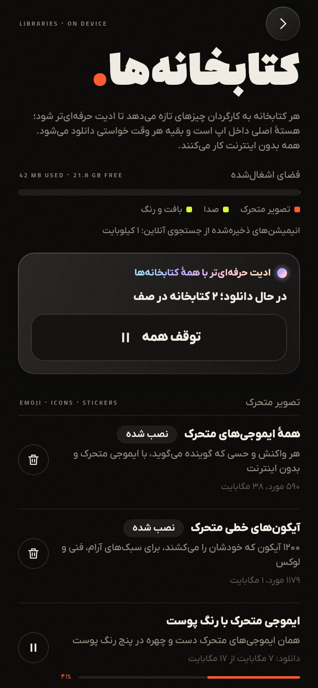

# المان‌ها، صدا و موسیقی

همهٔ Assetهای Trimio **با کد ساخته می‌شوند** (Procedural): هیچ فایل صوتی یا تصویری لایسنس نمی‌شود (تصمیم و منابع بررسی‌شده: `THIRD_PARTY_NOTICES.md`)، خروجی کاربر بدون محدودیت حق نشر است و نتیجه روی همهٔ پلتفرم‌ها یکسان است.

## المان‌های تصویری (`ElementClip.assetId`)

| شناسه | توضیح | پارامترها |
|---|---|---|
| `counter/…` | عدد شمارنده (ارقام فارسی برای محتوای فارسی) | `from`, `to`, `decimals`, `prefix`, `suffix`, `digits=fa`, `label` |
| `ticker/<symbol>` | کارت بازار: آیکون، نماد، درصد تغییر سبز/قرمز | `symbol`, `change`, `digits=fa` |
| `chart/candles` | نمودار شمعی با روند | `trend=up|down`, `seed` |
| `arrow/up` · `arrow/down` | فلش سود/ضرر | — |
| `badge/…` | برچسب متنی | `text` |
| `progress/…` | نوار پیشرفت | `value` (۰ تا ۱) |
| `icon/<id>` | ۲۰ آیکون برداری (`core/model/asset/IconCatalog.kt`) | — |


آیکون‌ها: coin، eth، dollar، gold، check، cross، star، bolt، heart، rocket، fire، trophy، target، bell، lock، clock، bulb، crown، gift، warning — هر کدام با کلیدواژه‌های فارسی و انگلیسی برای انتخاب خودکار.

## افکت‌های صوتی (`sfx/<id>`)

pop · click · tick · whoosh · whoosh-soft · swoosh · impact · shimmer · riser · ding · cash · glitch · rewind · swell · notify

### پالت صدای هر سبک (`sfx/<cue>@<palette>`)

هر افکت لایه‌لایه ساخته می‌شود، مثل چیدن چند نمونه روی هم: **ترنزینت** (کلیک کوتاه که از صدای گوینده رد می‌شود)، **بدنه** (وزن گام‌دار) و **دنباله** (نویز فیلترشده در فضا). شش پالت: `punchy`، `cinematic`، `soft`، `digital`، `luxe`، `playful`؛ هر کدام گام، طول، روشنی و اتاق لایه‌ها را تنظیم می‌کند. افکت‌ها: whoosh، impact، riser، tick، pop، swell، glitch، cash، notify.

در میکس، سطح هر نوع افکت نسبت به پیک صدای گوینده است؛ افکت تزئینی روی کلمه ۳ دسی‌بل پایین‌تر می‌آید (ضربه، بوم و ریوایند نه) و در هر دو ثانیه حداکثر ۴ افکت پخش می‌شود.

قرارداد با سبک‌ها: هر سبک یک برچسب صدا (`StyleLanguage.sound`) دارد و `SoundPresets.forTag(tag)` حس موسیقی و پالت افکت را برمی‌گرداند. برچسب‌ها: punchy، hype، cinematic، epic، luxury، elegant، minimal، corporate، warm، lofi، organic، ambient، tech، glitch، retro، dark، playful، bright (برچسب ناشناخته با کلیدواژه نگاشت می‌شود، مثل neon → tech).

## موسیقی (`music/<mood>`)

| حس | BPM | سازبندی |
|---|---|---|
| uplifting | 118 | کیک چهارضرب، کلپ، آرپژ پلاک، پد سوپرسا، باس هشتم |
| energetic | 126 | هت شانزدهم و هت باز، باس آف‌بیت، استب، سایدچین قوی |
| chill | 84 | گروو سوئینگ، الکتریک‌پیانو، وینیل، باس نرم |
| cinematic | 92 | ضربهٔ عمیق روی ۱ و ۳، تام، آرپژ، پد، ریورب بزرگ |
| corporate | 108 | کیبورد، آرپژ، کلپ، باس سبک |
| tense | 100 | باس پالسی هشتم، هت شانزدهم، تام، پد تیره |

`MusicComposer` قطعه را از استم‌ها می‌سازد (کیک لایه‌ای، کلپ، هت فلزی، کرش، باس، پد با حرکت صدایی، الکتریک‌پیانو، آرپژ با اکوی هم‌ضرب، رایزر) با سایدچین روی کیک و شبکهٔ ضرب دقیق تا نمونه. `Arranger` قطعه را برای همان ادیت می‌چیند: **intro → verse → build** (رول اسنیر، رایزر، سنج معکوس، یک ضرب سکوت) → **drop** (کرش و ساب) → **breakdown** زیر دعوت به اقدام → **outro** (آکورد پایانی روی ضرب اول میزان که تا فریم آخر طنین دارد). تمپو حداکثر ۶٪ کش می‌آید تا هم drop و هم ضربهٔ پایانی دقیقاً روی ضرب اول میزان بیفتند؛ drop روی بازگشت Cold open است و اگر نباشد روی نقطهٔ اوج (punchline یا خط بعد از قلاب).

بستر لوپ (`music/<mood>`) همان گروو در ۸ میزان است که بی‌درز لوپ می‌شود؛ میکسر زیر صدای گوینده آن را پایین می‌آورد (Ducking) و در پایان محو می‌کند.

## همگام‌سازی با ضرب

شبکهٔ ضرب (`BeatGrid`: تمپو و فاز ضرب اول میزان) در Score نوشته می‌شود (`bpm`، `beatOffset`) و Compiler ضربه‌های گرافیکی را روی ضرب می‌برد. برای موسیقی‌ای که اینجا ساخته نشده (بستهٔ دانلودی)، `BeatTracker` تمپو، ضرب‌ها و ضرب اول میزان را پیدا می‌کند: شار انرژی در سه باند، خودهمبستگی با وزن متریک، برازش خطی و شانه، و تغییر هارمونی (کروما) برای ضرب اول میزان؛ روی موسیقی مصنوعی خطای ضرب زیر ۵ میلی‌ثانیه است.

`AssetMatchingStage` شبکهٔ ضرب موسیقی را می‌سازد و ورود المان‌ها (و افکت ورودشان) را اگر ضربی در ±۱۲۰ میلی‌ثانیه باشد روی ضرب می‌برد؛ هیچ‌وقت دو المان روی هم نمی‌افتند.

## بسته‌های دانلودی («کتابخانه‌ها»)

سبک، تصویر متحرک، صدا، موسیقی، بافت، لوک رنگی و مدل به‌صورت **بستهٔ امضاشده** (Ed25519) جدا از اپ نصب و به‌روز می‌شوند. هستهٔ آفلاین داخل اپ است (موسیقی و افکت‌های رویه‌ای، سبک‌ها، فهرست تصویرها، پک شروع و **مجموعهٔ هسته**)؛ بقیه را کاربر بعد از نصب از صفحهٔ «کتابخانه‌ها» (تنظیمات ← کتابخانه‌ها، یا کارت پیشنهاد روی خانه بعد از راه‌اندازی) دانلود می‌کند. حجم APK اندروید با این طرح زیر ۱۵۰ مگابایت می‌ماند (مجموعهٔ هسته حدود ۹٫۴ مگابایت JSON، فشرده در APK حدود ۱ مگابایت).



### بسته‌ها (کانال `packs-v1`)

| شناسه | نوع | حجم | محتوا | مجوز (فقط برای تیم) |
|---|---|---|---|---|
| `art.noto-emoji` | Art | ۴۰٫۳ MB | ۵۹۰ ایموجی متحرک Noto (رنگ پیش‌فرض)، کلیدواژهٔ انگلیسی و فارسی CLDR | CC BY 4.0 — ببینید «ریسک مجوز» |
| `art.noto-emoji-tones` | Art | ۱۷٫۵ MB | ۲۵۵ ایموجی متحرک دست و چهره در پنج رنگ پوست | CC BY 4.0 |
| `art.line-md` | Art | ۱٫۴ MB | ۱۱۷۹ آیکون خطی متحرک (draw-on و تبدیل حالت‌ها؛ نشان برندها کنار گذاشته شده) | MIT |
| `art.motion-icons` | Art | ۰٫۰۲ MB | ۲۷ آیکون حرکتی (svg-spinners، بخش متحرک eos-icons) | MIT |
| `art.emoji-stickers` | Art | ۹٫۲ MB | ۳۱۲۴ استیکر رنگی Fluent Emoji Flat، کلیدواژهٔ CLDR | MIT |
| `art.line-stills` | Art | ۳٫۱ MB | ۷۸۱۷ آیکون خطی ثابت (Tabler و Lucide، بدون برند) | MIT و ISC |
| `sound.kenney-sfx` | Sound | ۱۶٫۵ MB | ۳۰۶ افکت ضبط‌شده (ضربه، ووش، سووش، پاپ، تیک، کلیک، درخشش) با نگاشت به پالت‌های صدا | CC0 1.0 (Kenney) |
| `music.kenney-stings` | Music | ۶٫۱ MB | ۸۵ استینگ کوتاه موسیقی | CC0 1.0 (Kenney) |
| `overlay.film-textures` | Overlay | ۱۳٫۸ MB | ۲۶ بافت: دانهٔ فیلم، گردوغبار و خط‌وخش، کاغذ، هاف‌تون، نشت نور، بوکه | ساخت خود ما |
| `look.cinematic-luts` | Look | ۱۷٫۳ MB | ۲۰ لوک رنگی ‎.cube‎ (۳۳ نقطه) | ساخت خود ما |
| **جمع** | | **≈ ۱۲۵ MB** | | |

ساخته‌شده و امضاشده در همین محیط: همهٔ ده بسته بالا (پوشهٔ موقت؛ در مخزن نیستند). متن مجوز MIT/ISC و CC0 داخل خود هر بسته (`art/LICENSE-*.txt`، `sound/LICENSE.txt`) است، نه در رابط کاربری. **هیچ متن ذکر نام یا نام شرکتی در اپ یا ویدیو اضافه نشده است** (تصمیم مالک).

**ریسک مجوز (برای مالک):** ایموجی متحرک Noto تحت CC BY 4.0 است و CC BY ذکر نام «به شیوهٔ معقول» را شرط می‌کند؛ تصمیم «هیچ ذکر نامی در اپ و ویدیو» با این شرط در تضاد است. یا باید ذکر نام در جایی غیر از ویدیو (صفحهٔ مجوزها یا توضیح پست) پذیرفته شود، یا این دو بسته منتشر نشوند و استیکرهای Fluent (MIT، بدون شرط ذکر نام) جای آن‌ها را بگیرند. بقیهٔ بسته‌ها شرط ذکر نام ندارند.

### چرا «چند گیگابایت» هنوز نه

منابعی که مجوزشان بدون ذکر نام، تجاری و قابل توزیع داخل اپ است و نویسندهٔ مشخص دارند، در مجموع همین حدود ۱۲۵ مگابایت بودند. برای رسیدن به چند گیگابایت با همین قاعده، روی ماشین یا CI بزرگ‌تر این‌ها اضافه می‌شود (اسکریپت‌ها همین ساختار را دارند):
- **موسیقی بستر CC0 با نویسندهٔ تأییدشده** (مثلاً آلبوم‌هایی که خود هنرمند با CC0 منتشر کرده) به‌صورت فهرست منتخب (URL + مدرک مجوز) در `build_sound_packs.py` (`SOURCES`)؛ هر آلبوم ۱۰۰ تا ۳۰۰ مگابایت.
- **ویدیوی اورلی واقعی** (نشت نور، دود، ذرات، گردوغبار ۴K) فقط از منبع CC0 یا ساخت خود تیم؛ هر بسته ۲۰۰ تا ۸۰۰ مگابایت.
- **پک‌های Lottie تیم** با `import_lottie.py` (پایین) از انیمیشن‌هایی که تیم خودش دانلود می‌کند.
- سقف هر فایل در GitHub Releases ۲ گیگابایت است؛ بسته‌های بزرگ‌تر به چند بخش با شناسهٔ جدا تقسیم می‌شوند.

### ساختار بسته و امنیت

- ظرف `.tpk`: `TPK1`، تعداد فایل، سپس برای هر فایل مسیر نسبی، اندازه و بایت‌ها؛ بدون فشرده‌سازی و بدون مسیر مطلق یا `..` (`PackArchive`).
- مانیفست (`PackManifest`): شناسه، نوع، نسخه، حجم، SHA-256، کلید، امضا، `minApp`، مجوز؛ عنوان و توضیح فارسی/انگلیسی، تعداد، حجم بازشده و «پیشنهادی». امضا روی سطرهای `trimio-pack/1، id، kind، version، size، sha256، minApp، license` است؛ نشانی‌ها امضا نمی‌شوند (هر آینه‌ای قبول است چون محتوا با هش امضاشده چک می‌شود).
- کلید عمومی در اپ پین شده است (`PackKeys.content`، شناسهٔ `packs-2026-1`). کلید خصوصی **هرگز** در مخزن یا اپ نیست: `python3 -I tools/packs/packlib.py keygen` آن را در `~/.config/trimio/pack-signing.key` می‌نویسد و CI آن را از Secret ‏`TRIMIO_PACK_KEY` می‌خواند. اپ برای خواندن کانال هیچ کلید یا رمزی لازم ندارد.
- نصب (`PackStore`): اول امضا، بعد بررسی فضای آزاد (حجم باقی‌ماندهٔ دانلود + حجم بازشده + ۶۴ مگابایت حاشیه)، بعد دانلود جریانی در فایل `.part` با **ادامه از همان‌جا** (HTTP Range؛ مکث، قطع اتصال یا بسته‌شدن اپ)، بعد اندازه و SHA-256، بازکردن در پوشهٔ موقت و جابه‌جایی اتمی؛ نسخهٔ قبلی برای بازگشت نگه داشته می‌شود و نسخهٔ قدیمی‌تر هرگز نصب نمی‌شود.
- محل نصب: اندروید `noBackupFilesDir/packs` (در بکاپ ابری نمی‌رود)، دسکتاپ `%APPDATA%\Trimio\packs\content`. دانلود اندروید زیر همان Job انتقال داده‌ای که مدل‌ها دارند ادامه می‌یابد.
- کانال (`PackChannel`): پیش‌فرض `https://github.com/BehnamJalaliCo/Trimio/releases/download/packs-v1/` (فایل `index.json` و همهٔ `.tpk`ها). سرور هتزنر بعدی فقط یک base تازه است؛ نشانی‌های مانیفست نسبی‌اند. فهرست آخر روی دیسک کش می‌شود و نسخهٔ لحظهٔ بیلد داخل اپ است (`files/core/index.json`) تا صفحه بدون اینترنت هم پر باشد.

### ساخت و انتشار

```bash
python3 -I tools/packs/packlib.py keygen                      # یک بار؛ کلید را در Secret بگذارید
python3 -I tools/packs/build_art_packs.py  WORK OUT --core feature/library/src/commonMain/composeResources/files/core
python3 -I tools/packs/build_sound_packs.py WORK/kenney OUT
python3 -I tools/packs/build_visual_packs.py WORK OUT
cp OUT/index.json feature/library/src/commonMain/composeResources/files/core/index.json
gh release create packs-v1 --title "Content packs v1" --notes "Signed content packs" OUT/index.json OUT/*.tpk   # یا: gh release upload packs-v1 … --clobber
python3 -I tools/packs/test_packs.py                          # تست ابزارها، بدون شبکه
```
نسخهٔ تازهٔ یک بسته: `--version N+1` و آپلود دوباره؛ اپ آن را «نسخهٔ تازه» نشان می‌دهد. انتشار روی GitHub در این مرحله انجام **نشده** است (کار سرپرست/مالک).

### استفادهٔ خودکار در ادیت (اول بسته، بعد اینترنت)

- `ContentPacks` (`engine/assets/.../packs`) فهرست بسته‌های نصب‌شده را از اپ می‌گیرد؛ هر نصب یا حذف از ادیت بعدی اعمال می‌شود.
- **تصویر:** ردیف‌های `art/index.json` هر بسته در همان جستجوی معنایی `ArtCatalogue` ادغام می‌شوند (`ArtShelf.bundled`)؛ مجموعهٔ هر بسته با `flavour` (ایموجی/خطی) به سبک‌ها وصل می‌شود. ترتیب سند: پک شروع ← بسته‌ها و مجموعهٔ هسته ← کش ← اینترنت در بودجهٔ زمانی موجود (۶ ثانیه هر درخواست، ۲۰ ثانیه کل). فهرست مجموعه‌های فقط‌بسته‌ای (svg-spinners و…) هم داخل اپ است، پس بدون نصب بسته با اینترنت از Iconify گرفته می‌شوند.
- **LottieFiles (فقط با کلید خود کاربر):** وقتی نه تصویرهای همراه و نه بسته‌ها پرسش را خوب نشان ندهند و اینترنت هست، API رسمی LottieFiles با کلید کاربر جستجو می‌شود (حداکثر یک درخواست در ثانیه، ۸ ثانیه سقف)، هر انیمیشن با خوانندهٔ موتور چک و در کش نگه داشته می‌شود.
- **صدا:** افکت ضبط‌شدهٔ بسته‌های صدا (با پالت سبک) جای نسخهٔ رویه‌ای همان افکت را در میکس می‌گیرد (`Soundtrack.addCues`)؛ رایزر و ریوایند رویه‌ای می‌مانند چون طولشان با ادیت تنظیم می‌شود.
- **هنوز وصل نشده (کار بعدی موتور):** موسیقی ضبط‌شده (بستر فعلاً رویه‌ای است و شبکهٔ ضرب از آن می‌آید)، اورلی‌های تصویری و LUTها (`ContentPacks.overlays()` و `looks()` آماده‌اند؛ رندرکننده و Compiler هنوز آن‌ها را نمی‌خوانند). برای موسیقی و افکت منبع آنلاین بدون کلید و با مجوز تمیز نداریم؛ بدون بسته همان رویه‌ای‌ها استفاده می‌شود.

### انیمیشن‌های خود کاربر و تیم

- **در اپ (دسکتاپ): «افزودن انیمیشن»** — انتخاب فایل‌های ‎.json/.lottie یا یک پوشه (و اختیاری یک CSV کلیدواژه)؛ هر فایل با خوانندهٔ واقعی موتور (`MotionArts.readOrWhy`) چک، از نام فایل و نام لایه‌ها برچسب‌گذاری و در بستهٔ محلی `art.mine` نصب می‌شود (`LottieImport`).
- **LottieFiles در اپ:** در صفحهٔ «کتابخانه‌ها» فیلد «کلید LottieFiles» (فقط روی همان دستگاه، در SecretStore). با کلید: جستجو یا فهرست برگزیده از API رسمی و دانلود موارد انتخاب‌شده یا همهٔ نتیجه‌ها (حداکثر ۶۰ در هر بار، یک درخواست در ثانیه) به بستهٔ محلی `art.lottiefiles`. بدون کلید: توضیح کوتاه، دکمهٔ باز کردن سایت و مسیر «افزودن انیمیشن». **هیچ خزش یا دانلود خودکار از وب‌سایت LottieFiles انجام نمی‌شود.**
- **برای تیم:** `python3 -I tools/packs/import_lottie.py <folder> --csv tags.csv --id art.team` همان بررسی (نسخهٔ پایتونی قواعد خواننده در `artcheck.py`) و برچسب‌گذاری را انجام می‌دهد و یک بستهٔ امضاشده برای کانال می‌سازد؛ مجوز باید یکی از مجوزهای پذیرفتهٔ اپ باشد (برای انیمیشن‌های رایگان LottieFiles: `Lottie-Simple-License`).

## تطبیق معنایی

`SemanticIndex` بردار n-gram حرفی (۲ تا ۴) از متن نرمال‌شده می‌سازد: «موشکی»، «rockets» و «آتیش» به آیکون درست می‌رسند، بدون دانلود مدل. جایگزینی با Embedding عصبی بدون تغییر رابط ممکن است (فاز ۹).

## تصویرهای متحرک از اینترنت (Animated pictures)

کارگردان برای هر لحظهٔ ادیت فقط به پک‌های همراه اپ محدود نیست: برای هر پرسش تصویری مدل (`visual`، انگلیسی) و معنای همان خط (فارسی)، بهترین تصویر متحرک را از منابع باز اینترنت پیدا می‌کند — ایموجی‌ای که حرکت می‌کند، یا آیکون خطی‌ای که خودش را می‌کشد — و هر جا که آن تصویر به‌خوبیِ بهترین آیکون ثابت موضوع را نشان دهد، تصویر متحرک جلو می‌افتد.

### منابع و مجوزها

| منبع | چه چیزی | مجوز | ذکر نام در ویدیو | دسترسی ماشینی |
|---|---|---|---|---|
| Noto Animated Emoji (Google) | ۶۱۱ ایموجی متحرک Lottie (بدون نسخه‌های رنگ پوست) | **CC BY 4.0** — صفحهٔ رسمی: «Animated Noto Emoji is licensed under CC BY 4.0» و در FAQ همان صفحه، استفاده در ویدیو و اپ تجاری با همین مجوز | **لازم**: `Animated emoji: Noto Emoji Animation by Google (CC BY 4.0)` | فهرست: `googlefonts.github.io/noto-emoji-animation/data/api.json`؛ سند: `fonts.gstatic.com/s/e/notoemoji/latest/<codepoint>/lottie.json` (بدون کلید) |
| Material Line Icons (`line-md`، Vjacheslav Trushkin) | ۱۱۳۱ آیکون خطی SVG متحرک (SMIL، draw-on)؛ آیکون برندها (اینستاگرام، یوتیوب…) کنار گذاشته شده‌اند | **MIT** | لازم نیست (متن مجوز در اپ) | Iconify API: `api.iconify.design/line-md.json?icons=<name>` (بدون کلید) |
| Unicode CLDR annotations | کلیدواژه‌های انگلیسی و **فارسی** ایموجی‌ها برای جستجو (فقط در فهرست، نه در ویدیو) | Unicode License v3 | — | `unicode-org/cldr-json` |

بررسی‌شده و **استفاده‌نشده**:

| منبع | چرا نه |
|---|---|
| LottieFiles (انیمیشن‌های رایگان) | خود «Lottie Simple License» استفادهٔ تجاری بدون ذکر نام را مجاز می‌داند، اما «جمع‌آوری یا گردآوری فایل‌ها از LottieFiles برای ساختن سرویس مشابه» را مستثنا می‌کند و شرایط سایت هر ربات، خزنده یا دانلود خودکار را منع می‌کند؛ API عمومی هم در شرایط پیش‌بینی نشده. نتیجه: هیچ دسترسی خودکاری نداریم. فایلی که خود کاربر از LottieFiles دانلود کند، می‌تواند بعداً به‌صورت «رسانهٔ کاربر» وارد شود. |
| OpenMoji | CC BY-SA 4.0: شرط ShareAlike ممکن است کل ویدیوی کاربر را مشمول همان مجوز کند. |
| Pexels / Pixabay (عکس و ویدیو) | مجوز محتوا استفادهٔ تجاری در ویدیو را می‌دهد، اما API کلید می‌خواهد و کلید در اپ عمومی امن نیست؛ Pixabay نگه‌داشتن دائمی/hotlink را محدود می‌کند و Pexels ذکر منبع در نمایش نتایج را می‌خواهد. راه درست: تنظیمی برای «کلید شخصی کاربر» و نمایش منبع؛ عکس/ویدیو هم از مسیر رسانه (MediaNode) می‌گذرد نه انیمیشن. در این مرحله پیاده نشده. |
| Wikimedia Commons | مجوز برای هر فایل جداست؛ فقط CC0 / مالکیت عمومی / CC BY قابل قبول است و CC BY-SA نه. فیلتر مجوز (`ArtLicence`) نام‌های Commons مثل «CC BY-SA 4.0» و «Public domain» را درست دسته‌بندی می‌کند، ولی منبع عکس هنوز وصل نشده. |
| Iconify `svg-spinners`، `meteocons` (MIT) | spinner ها تصویر موضوع نیستند؛ meteocons از `<symbol>/<use>`، گرادیان و clip-path استفاده می‌کند که خوانندهٔ SVG فعلاً رد می‌کند. |

قاعدهٔ مجوز در کد (`engine/assets/.../art/ArtLicence.kt`): مجاز = CC0، مالکیت عمومی، MIT/ISC/BSD/Apache-2.0 و CC BY (با ذکر نام). رد = هر نوع ShareAlike، NonCommercial، NoDerivatives، GPL، «فقط استفادهٔ شخصی» و هر مجوز ناشناخته. منبعی که مجوزش رد شود، اصلاً وارد فهرست نمی‌شود.

### ذکر نام (Attribution)

- هر ادیتی که تصویر CC BY نشان دهد، خط ذکر نامش را دارد: `Autopilot.Production.credits` (و `credit: …` در گزارش ساخت). جای درست آن متن اشتراک‌گذاری یا توضیح پست است (CC BY اجازهٔ ذکر نام «به شیوهٔ معقول برای همان رسانه» را می‌دهد)؛ چیزی روی خود ویدیو نوشته نمی‌شود.
- انیمیشن‌های همراه اپ (پک شروع) در فهرست مجوزهای اپ آمده‌اند: `docs/THIRD_PARTY_NOTICES.md` و `engine/autopilot/src/commonMain/composeResources/files/art/NOTICE.md`.
- تصویرهای MIT نیازی به ذکر نام در ویدیو ندارند؛ متن مجوز MIT در اپ کافی است.

### آفلاین اول، اینترنت در بودجهٔ زمانی

1. **فهرست همراه اپ** (`files/art/index.json`، ~۲۵۰ کیلوبایت): ۱۷۴۲ تصویر متحرک با کلیدواژهٔ انگلیسی و فارسی؛ جستجو بدون اینترنت.
2. **پک شروع** (`files/art/starter.json`، ~۷۹۰ کیلوبایت): ۱۹ ایموجی و ۲۸ آیکون خطی پرکاربرد (آتش، موشک، پول، هشدار، تیک، ضربدر، ایده، جام، هدف، نمودار، قلب، فلش‌ها…) که بدون اینترنت کشیده می‌شوند.
3. **اینترنت**: سند بقیه فقط وقتی لازم است گرفته می‌شود؛ هر درخواست حداکثر ۶ ثانیه و همهٔ جستجوهای تصویر یک ادیت روی هم حداکثر ۲۰ ثانیه (`VisualPicker`)؛ اینترنت کند یا فیلتر یعنی پک شروع و آیکون‌های ثابت.
4. **کش روی دیسک** (`DiskAssetCache`، حداکثر ۶۴ مگابایت؛ `WebKnowledge.cached`): هر سند یک بار گرفته می‌شود؛ ادیت بعدی یا بازسازی همان ادیت بدون شبکه است. سند هر انیمیشن داخل `Delivery` ادیت تحویل‌شده هم ذخیره می‌شود، پس پروژه بعد از بستن اپ بدون اینترنت دوباره ساخته می‌شود.

### انتخاب و ارتباط (Relevance)

`ArtCatalogue.search` پرسش انگلیسی مدل («rocket»، «chart decreasing») را کلمه‌به‌کلمه (با جمع و ‎-ing یکسان، اسم هسته با وزن دو) و با بردار n-gram حرفی همان `SemanticIndex` می‌سنجد و خط فارسی را با کلیدواژه‌های فارسی CLDR («موشک»، «آتش»). خروجی هر انتخاب یک عدد ارتباط ۰ تا ۱ است که برای آیکون‌های ثابت هم با همان معیار حساب می‌شود (`ArtCatalogue.relevance`) و در `Jury.Context.pictures` به هیئت داوران می‌رسد. سبک تعیین می‌کند کدام نوع اول است (`ArtFlavour`): سبک‌های پرانرژی، شاد و گرم ایموجی رنگی؛ سبک‌های آرام، سوئیسی، فنی و لوکس آیکون خطی به رنگ جوهر سبک (اگر فقط ایموجی مناسب باشد، با دو رنگ سبک بازرنگ می‌شود).

### رندر

خواننده و رندرکنندهٔ Lottie و SVG متحرک مال خود موتور است (`engine/motion/.../art`) و با Compose Graphics در همان `DrawScope` کشیده می‌شود: اندروید و دسکتاپ یک کد دارند، هر فریم مستقل و قطعی است (برای تاری حرکت و رندر چندرشته‌ای). پشتیبانی: لایهٔ شکل، null، solid و precomp؛ والد؛ time remap و stretch؛ مت آلفا و لوما؛ ماسک؛ گروه، path، مستطیل، بیضی، رنگ و گرادیان، خط و dash، trim path. رد می‌شود (به‌جای کشیدن غلط): لایهٔ متن و تصویر، سه‌بعدی، expression، افکت لایه، repeater. Merge path مثل پخش‌کنندهٔ مرجع وب ادغام‌نشده کشیده می‌شود. تصویر هرگز کشیده نمی‌شود (مقیاس یکنواخت)، جهت‌دار‌ها در متن راست‌به‌چپ قرینه می‌شوند و آیکون خطیِ روی فوتیج یک هالهٔ نرم به رنگ محافظ سبک پشتش می‌گیرد.

Compottie (Compose Multiplatform Lottie، MIT، نسخهٔ 2.3.3 روی Compose 1.12.1) بررسی شد: Painter آن فقط داخل یک Composable ساخته می‌شود (`LottiePainterImpl` و `AnimationState` داخلی‌اند و فریم از `derivedStateOf` خوانده می‌شود)، پس برای رندر خروجی بیرون از UI، در زمان‌های زیرفریمی و چند رشته مناسب نبود.
