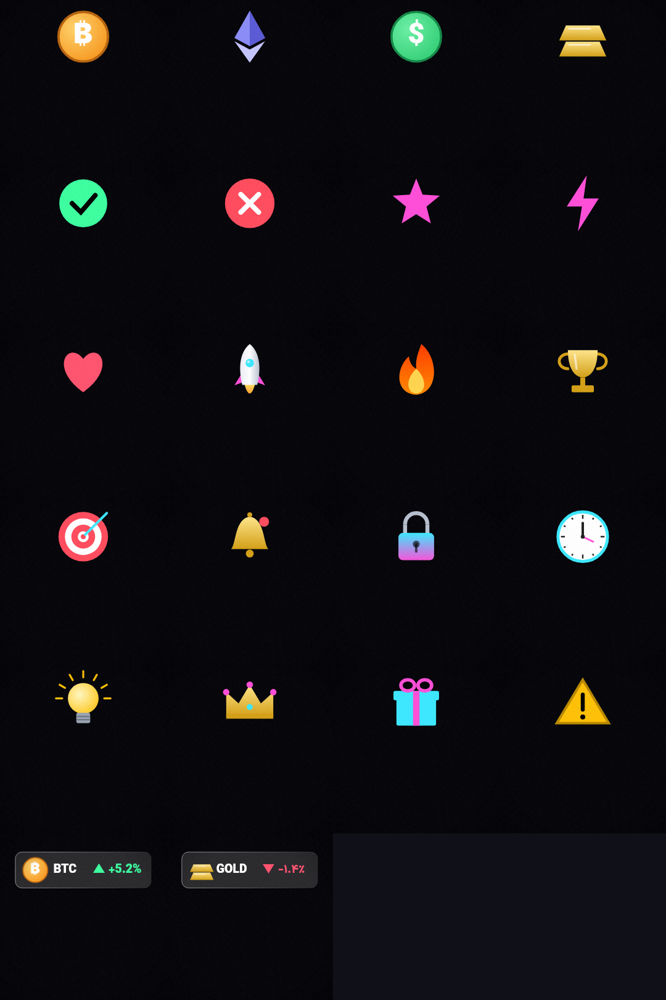

# المان‌ها، صدا و موسیقی

همهٔ Assetهای Trimio **با کد ساخته می‌شوند** (Procedural): هیچ فایل صوتی یا تصویری لایسنس نمی‌شود (تصمیم و منابع بررسی‌شده: `THIRD_PARTY_NOTICES.md`)، خروجی کاربر بدون محدودیت حق نشر است و نتیجه روی همهٔ پلتفرم‌ها یکسان است.

## المان‌های تصویری (`ElementClip.assetId`)

| شناسه | توضیح | پارامترها |
|---|---|---|
| `counter/…` | عدد شمارنده (ارقام فارسی برای محتوای فارسی) | `from`, `to`, `decimals`, `prefix`, `suffix`, `digits=fa`, `label` |
| `ticker/<symbol>` | کارت بازار: آیکون، نماد، درصد تغییر سبز/قرمز | `symbol`, `change`, `digits=fa` |
| `chart/candles` | نمودار شمعی با روند | `trend=up|down`, `seed` |
| `arrow/up` · `arrow/down` | فلش سود/ضرر | — |
| `badge/…` | برچسب متنی | `text` |
| `progress/…` | نوار پیشرفت | `value` (۰ تا ۱) |
| `icon/<id>` | ۲۰ آیکون برداری (`core/model/asset/IconCatalog.kt`) | — |

آیکون‌ها: coin، eth، dollar، gold، check، cross، star، bolt، heart، rocket، fire، trophy، target، bell، lock، clock، bulb، crown، gift، warning — هر کدام با کلیدواژه‌های فارسی و انگلیسی برای انتخاب خودکار.

## افکت‌های صوتی (`sfx/<id>`)

pop · click · tick · whoosh · whoosh-soft · swoosh · impact · shimmer · riser · ding · cash · glitch · rewind · swell · notify

### پالت صدای هر سبک (`sfx/<cue>@<palette>`)

هر افکت لایه‌لایه ساخته می‌شود، مثل چیدن چند نمونه روی هم: **ترنزینت** (کلیک کوتاه که از صدای گوینده رد می‌شود)، **بدنه** (وزن گام‌دار) و **دنباله** (نویز فیلترشده در فضا). شش پالت: `punchy`، `cinematic`، `soft`، `digital`، `luxe`، `playful`؛ هر کدام گام، طول، روشنی و اتاق لایه‌ها را تنظیم می‌کند. افکت‌ها: whoosh، impact، riser، tick، pop، swell، glitch، cash، notify.

در میکس، سطح هر نوع افکت نسبت به پیک صدای گوینده است؛ افکت تزئینی روی کلمه ۳ دسی‌بل پایین‌تر می‌آید (ضربه، بوم و ریوایند نه) و در هر دو ثانیه حداکثر ۴ افکت پخش می‌شود.

قرارداد با سبک‌ها: هر سبک یک برچسب صدا (`StyleLanguage.sound`) دارد و `SoundPresets.forTag(tag)` حس موسیقی و پالت افکت را برمی‌گرداند. برچسب‌ها: punchy، hype، cinematic، epic، luxury، elegant، minimal، corporate، warm، lofi، organic، ambient، tech، glitch، retro، dark، playful، bright (برچسب ناشناخته با کلیدواژه نگاشت می‌شود، مثل neon → tech).

## موسیقی (`music/<mood>`)

| حس | BPM | سازبندی |
|---|---|---|
| uplifting | 118 | کیک چهارضرب، کلپ، آرپژ پلاک، پد سوپرسا، باس هشتم |
| energetic | 126 | هت شانزدهم و هت باز، باس آف‌بیت، استب، سایدچین قوی |
| chill | 84 | گروو سوئینگ، الکتریک‌پیانو، وینیل، باس نرم |
| cinematic | 92 | ضربهٔ عمیق روی ۱ و ۳، تام، آرپژ، پد، ریورب بزرگ |
| corporate | 108 | کیبورد، آرپژ، کلپ، باس سبک |
| tense | 100 | باس پالسی هشتم، هت شانزدهم، تام، پد تیره |

`MusicComposer` قطعه را از استم‌ها می‌سازد (کیک لایه‌ای، کلپ، هت فلزی، کرش، باس، پد با حرکت صدایی، الکتریک‌پیانو، آرپژ با اکوی هم‌ضرب، رایزر) با سایدچین روی کیک و شبکهٔ ضرب دقیق تا نمونه. `Arranger` قطعه را برای همان ادیت می‌چیند: **intro → verse → build** (رول اسنیر، رایزر، سنج معکوس، یک ضرب سکوت) → **drop** (کرش و ساب) → **breakdown** زیر دعوت به اقدام → **outro** (آکورد پایانی روی ضرب اول میزان که تا فریم آخر طنین دارد). تمپو حداکثر ۶٪ کش می‌آید تا هم drop و هم ضربهٔ پایانی دقیقاً روی ضرب اول میزان بیفتند؛ drop روی بازگشت Cold open است و اگر نباشد روی نقطهٔ اوج (punchline یا خط بعد از قلاب).

بستر لوپ (`music/<mood>`) همان گروو در ۸ میزان است که بی‌درز لوپ می‌شود؛ میکسر زیر صدای گوینده آن را پایین می‌آورد (Ducking) و در پایان محو می‌کند.

## همگام‌سازی با ضرب

شبکهٔ ضرب (`BeatGrid`: تمپو و فاز ضرب اول میزان) در Score نوشته می‌شود (`bpm`، `beatOffset`) و Compiler ضربه‌های گرافیکی را روی ضرب می‌برد. برای موسیقی‌ای که اینجا ساخته نشده (بستهٔ دانلودی)، `BeatTracker` تمپو، ضرب‌ها و ضرب اول میزان را پیدا می‌کند: شار انرژی در سه باند، خودهمبستگی با وزن متریک، برازش خطی و شانه، و تغییر هارمونی (کروما) برای ضرب اول میزان؛ روی موسیقی مصنوعی خطای ضرب زیر ۵ میلی‌ثانیه است.

`AssetMatchingStage` شبکهٔ ضرب موسیقی را می‌سازد و ورود المان‌ها (و افکت ورودشان) را اگر ضربی در ±۱۲۰ میلی‌ثانیه باشد روی ضرب می‌برد؛ هیچ‌وقت دو المان روی هم نمی‌افتند.

## بسته‌های دانلودی

سبک، صدا، موسیقی و مدل به‌صورت بستهٔ امضاشده (Ed25519) جدا از اپ به‌روز می‌شوند؛ هستهٔ آفلاین (همین موسیقی و افکت‌های رویه‌ای و سبک‌های همراه) داخل اپ است. جزئیات و نگهداری کلید: `docs/SERVER.md`.

## تطبیق معنایی

`SemanticIndex` بردار n-gram حرفی (۲ تا ۴) از متن نرمال‌شده می‌سازد: «موشکی»، «rockets» و «آتیش» به آیکون درست می‌رسند، بدون دانلود مدل. جایگزینی با Embedding عصبی بدون تغییر رابط ممکن است (فاز ۹).
